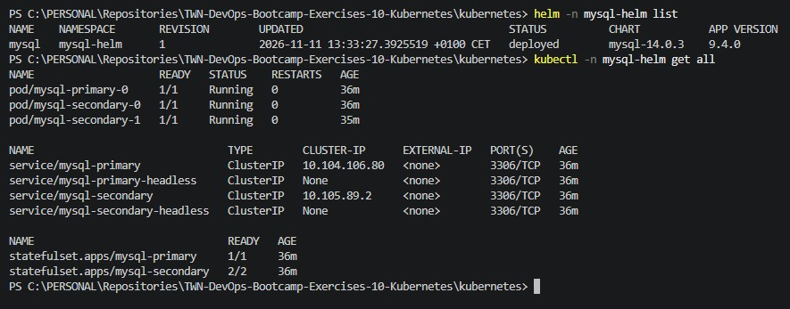

# Solutions for Exercises-10-Container-Orchestration-with-Kubernetes

## Exercise 1

**At first, I had to install KubeCTL, Minikube and Helm on my virtual Linux machine:**

```bash
# KubeCTL
curl -LO "https://dl.k8s.io/release/$(curl -L -s https://dl.k8s.io/release/stable.txt)/bin/linux/amd64/kubectl"
sudo install -o root -g root -m 0755 kubectl /usr/local/bin/kubectl
kubectl version --client

# Minikube
curl -LO https://storage.googleapis.com/minikube/releases/latest/minikube-linux-amd64
sudo install minikube-linux-amd64 /usr/local/bin/minikube
minikube version

# Helm
curl https://raw.githubusercontent.com/helm/helm/main/scripts/get-helm-3 | bash
helm version
```

> **Important!**
> After installing the necessary components, I realized that I don't have enough resources associated to my virtual machine.
> So I chose to use my Windows 11 PC for running Minikube.

**To start a cluster:**

```bash
minikube start
```

## Exercise 2

**The content of the kubernetes\mysql-helm-values.yaml file:**

```yaml
global:
  security:
    allowInsecureImages: true
image:
  registry: docker.io
  tag: latest
  repository: bitnamilegacy/mysql
 
architecture: replication

auth:
  rootPassword: "MYSQL_ROOT_PASSWORD"
  database: "MYSQL_DB_NAME"
  username: "MYSQL_USERNAME"
  password: "MYSQL_PASSWORD"

primary:
  persistence:
    storageClass: standard
    size: 1Gi

secondary:
  replicaCount: 2
  persistence:
    storageClass: standard
    size: 1Gi
```

**Installing and verifying the MySQL Helm chart:**

```bash
# Install Helm chart
helm install mysql oci://registry-1.docker.io/bitnamicharts/mysql -n mysql-helm --create-namespace -f kubernetes\mysql-helm-values.yaml

# Verification
helm -n mysql-helm list
kubectl -n mysql-helm get all
```

**The installed Helm chart:**



## Exercise 3
