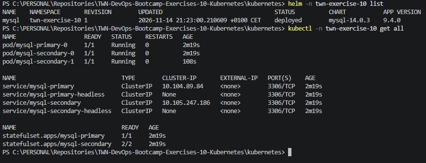
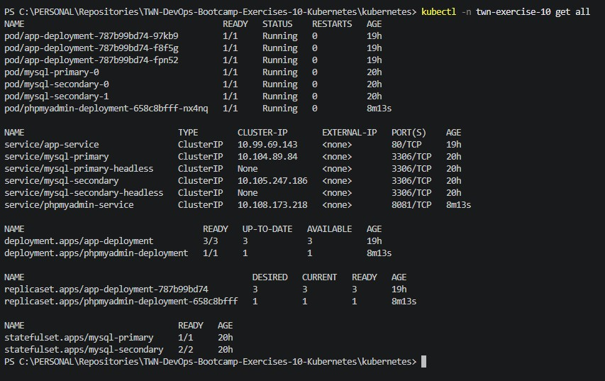
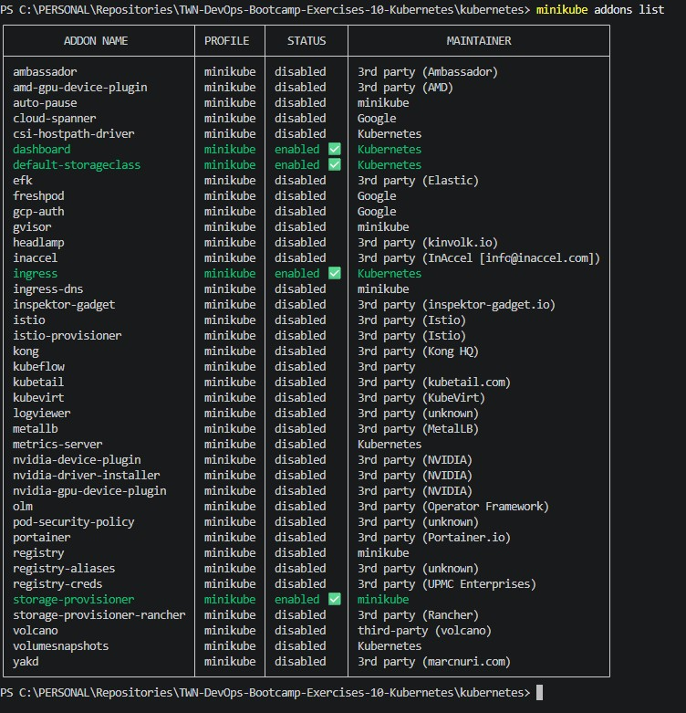

# Solutions for Exercises-10-Container-Orchestration-with-Kubernetes

## Exercise 1

**At first, I had to install KubeCTL, Minikube and Helm on my virtual Linux machine:**

```bash
# KubeCTL
curl -LO "https://dl.k8s.io/release/$(curl -L -s https://dl.k8s.io/release/stable.txt)/bin/linux/amd64/kubectl"
sudo install -o root -g root -m 0755 kubectl /usr/local/bin/kubectl
kubectl version --client

# Minikube
curl -LO https://storage.googleapis.com/minikube/releases/latest/minikube-linux-amd64
sudo install minikube-linux-amd64 /usr/local/bin/minikube
minikube version

# Helm
curl https://raw.githubusercontent.com/helm/helm/main/scripts/get-helm-3 | bash
helm version
```

> **Important!**
> After installing the necessary components, I realized that I don't have enough resources associated to my virtual machine.
> So I chose to use my Windows 11 PC for running Minikube.

**To start a cluster:**

```bash
minikube start
```

## Exercise 2

**The content of the kubernetes\mysql-helm-values.yaml file:**

```yaml
global:
  security:
    allowInsecureImages: true
image:
  registry: docker.io
  tag: latest
  repository: bitnamilegacy/mysql
 
architecture: replication

auth:
  rootPassword: "MYSQL_ROOT_PASSWORD"
  database: "MYSQL_DB_NAME"
  username: "MYSQL_USERNAME"
  password: "MYSQL_PASSWORD"

primary:
  persistence:
    storageClass: standard
    size: 1Gi

secondary:
  replicaCount: 2
  persistence:
    storageClass: standard
    size: 1Gi
```

**Installing and verifying the MySQL Helm chart:**

```bash
cd kubernetes

# Install Helm chart
helm install mysql oci://registry-1.docker.io/bitnamicharts/mysql -n twn-exercise-10 --create-namespace -f mysql-helm-values.yaml

# Verification
helm -n twn-exercise-10 list
kubectl -n twn-exercise-10 get all
```

**The installed Helm chart:**



## Exercise 3

**Because of some incompatibility errors, I had to temporarily set the main Java version for building:**

```bash
export JAVA_HOME=/usr/lib/jvm/java-17-openjdk-amd64
gradle build
```

**I had an error according to MySql version.**
**So in the build.gradle I had to exchange the mysql row in the dependencies section for this:**

```bash
implementation 'com.mysql:mysql-connector-j:9.2.0'
```

**After that I had to run again the gradle build command and build the docker image:**

```bash
# Rerun gradle build.
gradle build

# Build and tag the Docker image.
docker build -t twn-exercise10-app:1.0 .
docker tag twn-exercise10-app:1.0 bodnarimredocker/twn-exercise10-app:1.0

# Login and push to my DockerHub account.
docker login
docker push bodnarimredocker/twn-exercise10-app:1.0
```

**The contents of `app-configmap.yaml`:**

```yaml
apiVersion: v1
kind: ConfigMap
metadata:
  name: app-db-config
data:
  DB_SERVER: mysql-primary
  DB_NAME: java-app-db
```

**The contents of `app-secret.yaml`:**

```yaml
apiVersion: v1
kind: Secret
metadata:
  name: app-db-secret
type: Opaque
data:
  DB_USER: aW1yZQ==
  DB_PWD: dDV6NnU3aTg=
```

**The contents of `app-deployment.yaml`:**

```yaml
apiVersion: apps/v1
kind: Deployment
metadata:
  name: app-deployment
spec:
  replicas: 3
  selector:
    matchLabels:
      app: twn-java-app
  template:
    metadata:
      labels:
        app: twn-java-app
    spec:
      imagePullSecrets:
        - name: dockerhub-secret
      containers:
        - name: twn-exercise10-app
          image: bodnarimredocker/twn-exercise10-app:1.0
          ports:
            - containerPort: 8080
          env:
            - name: DB_USER
              valueFrom:
                secretKeyRef:
                  name: app-db-secret
                  key: DB_USER
            - name: DB_PWD
              valueFrom:
                secretKeyRef:
                  name: app-db-secret
                  key: DB_PWD
            - name: DB_SERVER
              valueFrom:
                configMapKeyRef:
                  name: app-db-config
                  key: DB_SERVER
            - name: DB_NAME
              valueFrom:
                configMapKeyRef:
                  name: app-db-config
                  key: DB_NAME
```

**The contents of `app-service.yaml`:**

```yaml
apiVersion: v1
kind: Service
metadata:
  name: app-service
spec:
  selector:
    app: twn-java-app
  ports:
    - protocol: TCP
      port: 8080
      targetPort: 8080
```

**Finally it's time for deploying!**
**At first I created a docker-registry type secret what I can use in the `imagePullSecrets` section to login to Docker before pulling the needed image.**
**After that I applied my manifests.**

```bash
cd kubernetes

kubectl create secret docker-registry dockerhub-secret --docker-email=DOCKER_MAIL_ADDRESS --docker-username=bodnarimredocker --docker-password=DOCKER_PASSWORD --docker-server=https://index.docker.io/v1/ -n twn-exercise-10

kubectl apply -f app-configmap.yaml -n twn-exercise-10
kubectl apply -f app-secret.yaml -n twn-exercise-10
kubectl apply -f app-deployment.yaml -n twn-exercise-10
kubectl apply -f app-service.yaml -n twn-exercise-10

kubectl get all -n twn-exercise-10
```

## Exercise 4

**The newly added `phpmyadmin-deployment.yaml` file's content:**

```yaml
apiVersion: apps/v1
kind: Deployment
metadata:
  name: phpmyadmin-deployment
spec:
  replicas: 1
  selector:
    matchLabels:
      app: twn-phpmyadmin
  template:
    metadata:
      labels:
        app: twn-phpmyadmin
    spec:
      containers:
        - name: twn-phpmyadmin-container
          image: phpmyadmin:5.2.3
          ports:
            - containerPort: 80
          env:
            - name: PMA_HOST
              valueFrom:
                configMapKeyRef:
                  name: app-db-config
                  key: DB_SERVER
---
apiVersion: v1
kind: Service
metadata:
  name: phpmyadmin-service
spec:
  selector:
    app: twn-phpmyadmin
  ports:
    - protocol: TCP
      port: 8081
      targetPort: 80
```

**I used these commands to deploy a PhpMyAdmin instance into the cluster:**

```bash
cd kubernetes

kubectl apply -f phpmyadmin-deployment.yaml -n twn-exercise-10

kubectl get all -n twn-exercise-10
```

**PhpMyAdmin is added to the cluster:**



## Exercise 5

**Because the `ingress` addon is part of Minkube, I just need to enable it:**

```bash
# Enable ingress.
minikube addons enable ingress
# Verification.
minkube addons list
```

**My MiniKube addon list:**


